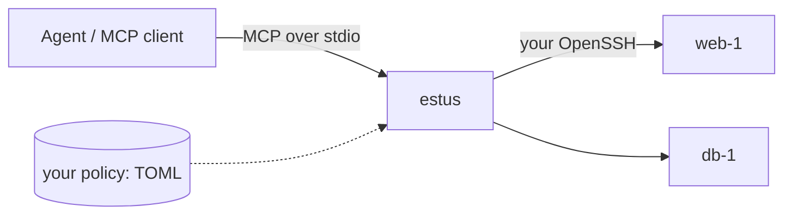

# Estus

**Keep SSH in your hands.**

Estus is an [MCP](https://modelcontextprotocol.io) server that lets an AI agent
triage and operate Linux hosts over SSH, through structured, policy-gated tools
instead of a raw shell.


> **Status: pre-1.0.** Configuration format and tool schemas may change between
> releases. Read the [security model](docs/security.md) before pointing Estus at
> anything you care about.

## Why

Giving an agent `ssh` gives it a shell with all of your access, and "allow this
command?" prompts are hard to review. Estus sits in between. The agent calls
named tools with typed arguments, and you decide, per host, which tools exist
and what they can touch.

- **Tools, not shell strings.** `observe_memory`, `inspect_journal`,
  `change_systemd_unit`. Catalog tools take fixed, typed inputs and return
  structured results, so there are no flags or paths to smuggle in.
- **Policy per host.** Production can be read-only while staging may restart
  services. Rules combine by "strictest wins", so file order never weakens them.
- **Tiered for approvals.** Every tool is `observe`, `inspect`, `preview`,
  `change` or `exec`. Auto-approve reads; prompt for the rest.
- **Honest about failure.** If a change's acknowledgement is lost, Estus doesn't
  guess. It locks writes on that host and never retries. You reconcile, then
  unlock.
- **Your SSH, your credentials.** Estus runs your OpenSSH. It never sees, stores
  or asks for keys, and uses your host-key checking and `ProxyJump`. Targets
  need only `sshd` and `python3` (3.8+).

## How it works



Your MCP client starts Estus as a local process. Estus validates each call
against your policy, runs it over SSH, and returns a structured result.

### An example

You ask: *"Is web-1 under memory pressure?"* The agent calls `observe_memory`:

```json
{"host": "web-1", "inputs": {}}
```

```json
{
  "data": {
    "status": "successful",
    "complete": true,
    "changed": false,
    "host": "web-1",
    "projection": {
      "status": "complete",
      "value": {
        "memory_bytes": {
          "mem_total_bytes": 33532788736,
          "mem_available_bytes": 32737964032,
          "swap_total_bytes": 1073733632,
          "swap_free_bytes": 1073733632
        },
        "vm_counters": { "oom_kill_events": 0, "swap_out_pages": 0 }
      }
    }
  },
  "error": null
}
```

*(Trimmed for length.)* The agent never wrote a shell command, and could not have
asked for anything outside this tool's schema.

### Tiers

| Tier | Meaning | Suggested approval |
| --- | --- | --- |
| `observe` | Read-only telemetry | allow |
| `inspect` | Sensitive reads (logs, files, processes) and active probes | ask |
| `preview` | "What would this change do?", read-only | ask |
| `change` | One mutation | ask |
| `exec` | Arbitrary remote execution | ask |

Estus ships a large catalog of reviewed tools (systemd, network, storage,
kernel, packages, logs and more) that you opt into by name or by preset. It also
has a few generic builtin tools for files and commands. They are off until you
enable them in `[capabilities]`: reading files, writing files, running commands
and sudo are separate switches. See [concepts](docs/concepts.md).

## Install

**Nix** (includes the tool catalog):

```sh
nix run github:aw1cks/estus -- --config /path/to/estus.toml
```

**Cargo.** Needs Rust 1.88+. The tool catalog is built into the binary; write it
to disk once, next to the binary, where Estus looks for it:

```sh
cargo install --git https://github.com/aw1cks/estus --locked
estus catalog install
```

After upgrading, run `estus catalog install --replace` to refresh it.

**Python wheel.** Building needs Rust 1.88+ and Python 3.10+; the installed
wheel runs on Python 3.8+ and includes the catalog.

```sh
git clone https://github.com/aw1cks/estus && cd estus
uv build --wheel
uv tool install ./dist/estus-*.whl
estus --version
```

Estus needs OpenSSH on the machine that runs it. macOS and Linux are supported;
targets are Linux. Other build options are in
[building from source](docs/development/building.md).

## Quick start

A config with one host, read-only:

```toml
mode = "headless"
capabilities = { named = true, file_read = true }

[selection]
presets = ["linux-health"]

[targets.web-1]
ssh_host = "web-1"                # a Host from your ssh config

[automation.targets.web-1]
destination = "web-1"
python = "/usr/bin/python3"
```

Check what it allows, without connecting anywhere:

```sh
estus --config estus.toml auth explain web-1
```

Then add it to your MCP client. For Claude Code:

```sh
claude mcp add estus -- estus --config /absolute/path/to/estus.toml
```

[Getting started](docs/getting-started.md) goes through this step by step, and
[Connecting a client](docs/clients.md) covers other clients and approval rules.

## Security

Estus is a policy and honesty layer between an agent and OpenSSH. It is **not a
sandbox**: `exec_command` runs arbitrary shell on the target when you enable it,
and anything that runs as the same OS user as Estus can bypass it. The
[security model](docs/security.md) says what is and isn't enforced, and
[deployment](docs/deployment.md) shows how to run it with separated accounts.
To report a vulnerability, see [SECURITY.md](SECURITY.md).

## Documentation

- [Getting started](docs/getting-started.md): zero to a working read-only setup
- [Concepts](docs/concepts.md): tools, tiers, targets, policy, previews, quarantine
- [Connecting a client](docs/clients.md): Claude Code and other MCP clients
- [Configuration](docs/configuration.md) and [policy](docs/policy.md): every key, with recipes
- [Catalog](docs/catalog.md) and the [per-tool reference](docs/tools/catalog-reference.md)
- [Troubleshooting](docs/troubleshooting.md)
- [All documentation](docs/README.md), [examples](examples/README.md) and [contributing](CONTRIBUTING.md)

## License

[AGPL-3.0-or-later](LICENSE).
