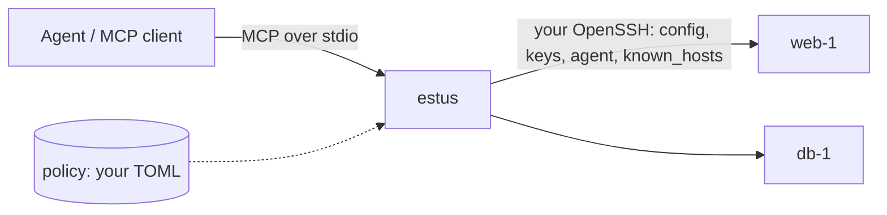

# Concepts

The mental model behind Estus. Read this once and the rest of the docs will make
sense. Terms in **bold** are used consistently everywhere else.

## The shape of it



Estus is a local process that your MCP client starts. The agent never gets a
shell. It calls **tools**, and Estus decides whether each call is allowed,
validates it, runs it over SSH, and returns a structured result.

Estus does not store, create or prompt for credentials. It shells out to the
OpenSSH you already have, so host-key checking, `IdentityFile`, agents and
`ProxyJump` all behave the way they do when you run `ssh` yourself.

## Tools

A **tool** is one operation the agent can call, such as `observe_memory`,
`inspect_journal` or `change_systemd_unit`. Tools come from two places:

- **Builtin tools.** Generic building blocks: file read/write over SFTP,
  `exec_command`/`exec_argv`/`exec_sudo`, target discovery and output handles.
  They are powerful and broad. See [builtin tools](tools/builtin.md).
- **Catalog tools.** Narrow, reviewed operations such as "read PSI
  pressure", "page the journal", "restart one allow-listed unit". Each has a
  fixed input schema and a fixed result shape. They are opt-in: installing Estus
  enables none of them. See the [catalog](catalog.md) and the
  [per-tool reference](tools/catalog-reference.md).

Prefer catalog tools. They can't do more than their schema allows, and their
results are small and predictable. The builtins are the escape hatch for what
the catalog doesn't cover.

Most catalog tools are Python collectors that Estus sends to the target over SSH
and runs with the target's `python3`. A few, mainly the package tools, drive
Ansible modules and need an [offline bundle](ansible-bundles.md). The builtins
need nothing on the target except SSH (and SFTP for file tools).

## Tiers

Every tool is labelled with a **risk tier**, published as `_meta.risk_tier`. The
tier is what you configure your client's approval prompts on.

| Tier | Meaning | Suggested client approval |
| --- | --- | --- |
| `observe` | Read-only telemetry | allow |
| `inspect` | Sensitive reads (files, logs, processes) or active probes | ask |
| `preview` | Read-only "what would this change do?" check | ask |
| `change` | One mutation | ask |
| `exec` | Arbitrary remote execution | ask |

Tool names carry the tier as a prefix (`observe_cpu`, `change_package`), so you
can also write approval rules by name. See [clients](clients.md).

## Targets

A **target** is a named host in your config:

```toml
[targets.web-1]
ssh_host = "web-1"   # any OpenSSH destination
```

The agent passes `host = "web-1"` on every call. In a normal (headless)
configuration the `[targets]` table is a closed list: the agent can only name
hosts you declared, and an alias in your `~/.ssh/config` doesn't grant anything
by itself.

## Modes

- **Headless** is the default for any config file. Targets are a closed list and
  only the capabilities you enable are exposed. Use this for anything real.
- **Workstation** (`--workstation`, or `mode = "workstation"` in a config file) is
  for local development. Unless the config declares `[targets]`, the agent may
  name any SSH destination, and with no config file `--workstation` opens every
  capability. There is deliberately no environment-variable switch, so a stray
  variable can't widen access.
- `--yolo` goes further still (root sudo, every non-lab catalog tool). It exists
  for throwaway test machines. It can't be combined with a config file.

## How a call is authorized

Policy is layered, and each layer can only narrow what the one above allows:

1. **Capabilities** decide which builtin tools exist at all. There are five
   switches: `named` (catalog tools), `file_read`, `file_write`, `exec`, `sudo`.
   A tool whose capability is off isn't published; the agent can't even see it.
2. **Selection** decides which catalog tools are enabled, by name or by preset
   (`presets = ["linux-health"]`). `deny` always wins.
3. **Per-target narrowing.** Each `[targets.<name>]` can lower the tier ceiling
   (`max_tier`), narrow the selection, and require previews.
4. **Profiles and groups** give hosts reusable policy by name or label, for
   example "anything matching `*.prod.internal` is read-only". When several
   apply, the strictest wins, regardless of file order.
5. **Per-call validation** happens before any connection: argument shapes,
   bounds, byte caps. A rejected call never touches the network.

You can ask Estus what it would decide, without connecting:

```sh
estus --config estus.toml auth explain db-1
estus --config estus.toml auth can-i exec_command db-1   # exit 0 = yes, 1 = no
```

Details are in [policy](policy.md).

## Preview before change

`preview_*` tools run a change in check mode and report what *would* happen. A
preview is single-use, tied to the exact arguments you gave it, and expires after
five minutes.

With `require_preview = true`, mutations must be backed by a fresh matching
preview, and anything that can't be previewed is refused with `preview_required`:

- A catalog `change` tool that has a preview pairing runs only after you've run
  that preview with the same arguments.
- A catalog `change` tool with **no** pairing is refused.
- The **builtin** `change_*` and `exec_*` tools have no previews, so they are
  refused too. `require_preview` therefore acts as "only previewable changes".
  Reads, observations and `change_target_quarantine_clear` are unaffected.

It can be set globally and overridden per target; the target setting wins, in
either direction.

## When a change goes wrong: uncertainty and quarantine

SSH connections drop, and sometimes you don't know whether a change landed. Estus
never guesses. If a mutation was sent but its acknowledgement was lost, the
result carries `remote_state_unknown = true` and Estus **quarantines writes on
that host**. Further changes fail with `target_quarantined`. Reads, inspections
and previews keep working so you (or the agent) can look at the real state.

A change is never retried or replayed, and a closed channel is never taken as
proof of rollback. Once you've checked the host yourself, clear the gate with
`change_target_quarantine_clear` and `acknowledge_remote_state_reconciled = true`.
Set `[quarantine] state_dir` if the quarantine should survive a restart.

## Authority

Builtin tools use the ordinary SSH identity you configured. Catalog tools run
under an **authority** that says which identity and route they use:

- `automation`: the ordinary SSH identity, running a collector with the target's
  Python.
- `automation:<name>`: a **named authority**, with its own SSH config, optional
  bundle and a fixed sudo `become`. This is how you give privileged catalog tools
  (package changes, service restarts) a separate identity from the one used for
  reads.

Separating identities matters because shell access on the ordinary account can
bypass sudo rules on that same account. See [deployment](deployment.md).

## Output handles

Big command output isn't pushed through the model's context. With
`retain_output = true`, `exec_*` keep stdout/stderr locally and return a handle;
the agent reads ranges with `inspect_output`. Handles are session-scoped and
expire.

## What Estus is not

It is not a sandbox. `exec_command` runs arbitrary shell on the target, and the
file tools take literal paths. What Estus gives you is control over *which*
operations an agent can reach on *which* hosts, plus honest failure reporting.
Anything that can run as the same OS user as Estus can bypass it entirely. Read
the [threat model](security.md) before using it on hosts you care about.

## Glossary

| Term | Meaning |
| --- | --- |
| Builtin tool | One of the 15 generic tools compiled into Estus |
| Catalog tool | A reviewed, opt-in operation from the bundled catalog (config key `[tools.<name>]`; older docs and some error messages call these "named bindings") |
| Capability | One of five switches that publish groups of builtin tools |
| Tier | `observe`, `inspect`, `preview`, `change` or `exec` |
| Target | A named host in `[targets]` |
| Selection | The set of catalog tools enabled globally or per target |
| Profile / group | Reusable policy, applied to hosts by name or label |
| Authority | The identity and route a catalog tool runs under |
| Preset | A named list of catalog tools (`linux-health`, ...) |
| Quarantine | Write lock on a host after an uncertain mutation |
| Handle | Opaque reference to retained command output |
