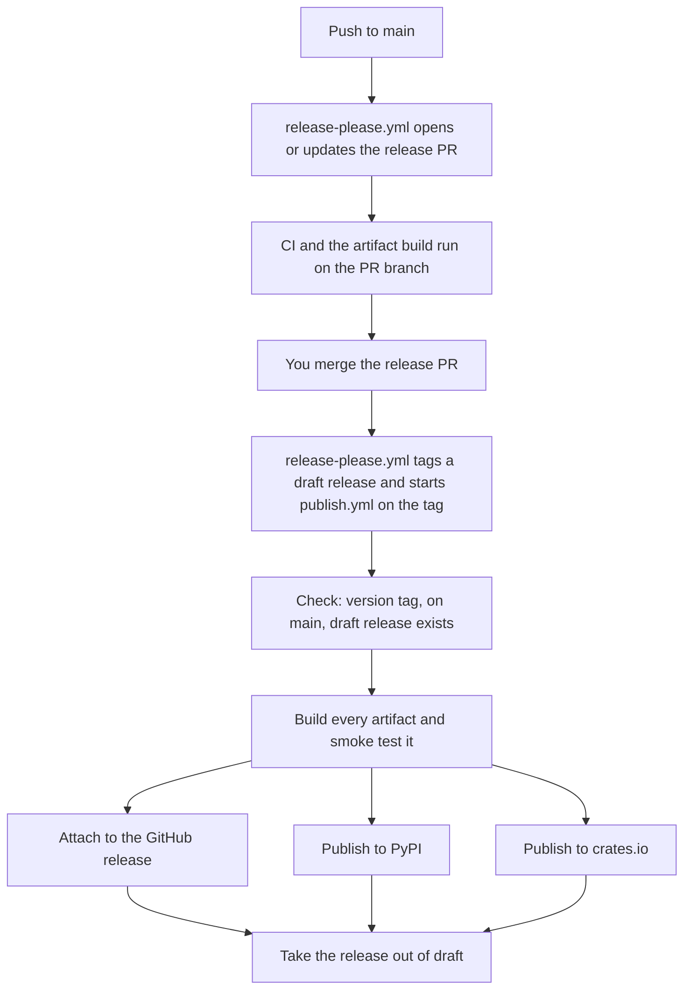

# Releasing

How Estus releases are made and published. You need this if you maintain the repository. Contributors only need the [commit message convention](../../CONTRIBUTING.md#before-opening-a-pull-request).

Releases are automatic once set up. [release-please](https://github.com/googleapis/release-please) keeps a release pull request open, built from the Conventional Commit messages on `main`. Merging that pull request tags a draft release, and publishing then runs against that tag.



Two workflows split the work. `release-please.yml` runs on every push to `main` and only manages the release pull request and the tag. `publish.yml` builds and publishes, and only for an unpublished release on a `v*` tag that is on `main`; run anywhere else, its first job stops it. The release stays a draft until every channel has published, so nobody sees a release with missing files.

A tag that release-please creates with the workflow's `GITHUB_TOKEN` does not start other workflows, so an `on: push: tags` trigger alone would never fire. `release-please.yml` therefore starts `publish.yml` on the new tag itself. `publish.yml` also runs on a `v*` tag push, which covers a tag you push yourself.

## What gets published

| Artifact | Name | Runs on |
| --- | --- | --- |
| Linux binary, glibc | `estus-{x86_64,aarch64}-unknown-linux-gnu.tar.gz` | glibc 2.34 or later: RHEL 9, Ubuntu 22.04, Debian 12 |
| Linux binary, static | `estus-{x86_64,aarch64}-unknown-linux-musl.tar.gz` | Any Linux, including Alpine and older glibc systems |
| macOS binary | `estus-aarch64-apple-darwin.tar.gz` | Apple silicon |
| Wheel, glibc | `estus-<version>-py3-none-manylinux_2_34_<arch>.whl` | glibc 2.34 or later |
| Wheel, static | `estus-<version>-py3-none-manylinux2014_<arch>.musllinux_1_2_<arch>.whl` | Alpine, and glibc systems older than 2.34 |
| Wheel, macOS | `estus-<version>-py3-none-macosx_11_0_arm64.whl` | Apple silicon |
| Source distribution | `estus-<version>.tar.gz` | Building from source |
| Crate | `estus-mcp` on crates.io | `cargo install estus-mcp` installs the `estus` command |
| Checksums | `SHA256SUMS` | Covers every file above except the crate |

Each binary tarball unpacks to `estus-<target>/bin/estus` with the catalog at `estus-<target>/share/estus/catalog`. Estus looks for the catalog next to the binary, so an extracted tarball works with no install step. The tarball names carry no version, so `releases/latest/download/<name>` is a stable URL.

The static wheel holds the static musl binary, which depends on no libc. That is why it can claim both musl and the oldest glibc baseline. pip picks the glibc wheel wherever it installs, and falls back to the static one elsewhere, so a user on RHEL 8 or Ubuntu 20.04 still gets a wheel instead of a source build. Estus makes no name-service calls of its own (`ssh` is a separate process), so the two builds behave the same.

The crate is named `estus-mcp` because `estus` on crates.io belongs to someone else. The program, the library and the PyPI project are all still `estus`.

## How commits become a version

Release notes and the version bump come from commit subjects on `main`. While the version is below 1.0:

| Commit | Effect |
| --- | --- |
| `feat!:` or a `BREAKING CHANGE:` footer | Minor bump |
| `feat:` | Minor bump |
| `fix:`, `perf:` | Patch bump |
| `docs:`, `chore:`, `ci:`, `build:`, `test:`, `refactor:` | No release by themselves, and hidden from the notes |

The notes are written into the release pull request, so edit them there (and in `CHANGELOG.md` on the PR branch) before merging. `CHANGELOG.md` belongs to release-please; don't edit it outside a release pull request.

release-please updates the version in `Cargo.toml`, `Cargo.lock` and `pyproject.toml` in the release pull request. Never change those by hand.

## One-time setup

The workflows can't do these for you.

1. **Pull requests.** In the repository's Settings, Actions, General, allow GitHub Actions to create and approve pull requests.
2. **Environments.** Create two environments, `pypi` and `crates-io`. In each, under deployment branches and tags, allow only tags matching `v*`, so nothing but a release tag can publish. Adding a required reviewer gives you a manual gate as well.
3. **PyPI.** Add a pending trusted publisher for the project `estus` with owner `aw1cks`, repository `estus`, workflow `publish.yml` and environment `pypi`. No token is stored; PyPI trusts the workflow.
4. **crates.io.** Add a trusted publisher to `estus-mcp` (crate settings, Trusted Publishing) with owner `aw1cks`, repository `estus`, workflow `publish.yml` and environment `crates-io`, then turn on "Trusted Publishing only" so that no API token can publish it. No secret is stored: the publish job exchanges its OIDC token for a short-lived crates.io token, which is revoked when the job ends. crates.io only offers trusted publishing for a crate that already exists, so a brand-new crate needs one publish with a scoped API token first; `estus-mcp` was first published that way, as 0.1.0.
5. **Rulesets.** Three repository rulesets protect the release path. `main: integrity` blocks deleting `main`, force pushes to it, and non-linear history, with no bypass. `main: pull requests` requires a pull request and the two Linux SSH baseline checks; repository admins can bypass it in an emergency. `release tags` stops `v*` tags from being deleted or moved once created, with an admin bypass; release-please can still create them, because creating a tag isn't restricted.

## The first release

`.github/release-please-config.json` sets `initial-version` to `0.1.0` and `bootstrap-sha` to the commit before the release machinery landed, and `.github/release-please-manifest.json` starts empty. The first release pull request therefore proposes `0.1.0` and lists only the commits after that point, not the project's whole history. Read it, trim the notes if you like, and merge. You can delete `bootstrap-sha` from the config afterwards; release-please ignores it once a release exists.

## Check a build without releasing

Everything the release does to build and test an artifact is a command in `scripts/release.py`, run inside the release dev shell so the Rust and zig versions are the pinned ones:

```sh
nix develop .#release -c python3 scripts/release.py binaries --out dist/release
nix develop .#release -c python3 scripts/release.py wheels --out dist/release
nix develop .#release -c python3 scripts/release.py sdist --out dist/release
nix develop .#release -c python3 scripts/release.py smoke dist/release
```

| Command | What it proves |
| --- | --- |
| `binaries` | Builds each target, then checks it: a glibc binary needs no symbol newer than `GLIBC_2.34`, a musl binary is fully static, and a macOS binary links only system libraries. |
| `wheels` | Builds each wheel and runs the same checks on the binary inside it. |
| `sdist` | Builds the source distribution. |
| `smoke` | Installs each artifact in a container of the system it targets (AlmaLinux 9, Ubuntu 20.04, Alpine, or macOS itself), then checks the version, the bundled catalog and a real MCP handshake. It also confirms that pip refuses the glibc wheel on a system below the floor. |

By default each command builds the targets for the machine it runs on: all four Linux targets on Linux, and the macOS target on macOS. Pass `--target <triple>` (repeatable) to build others. Linux targets cross-build from any host, so on a Mac, `--target x86_64-unknown-linux-gnu` works. `smoke` uses Docker for Linux artifacts and tests only those matching your machine's architecture; on macOS it tests the macOS artifacts natively unless you pass `--mode docker`.

The **Release artifacts** workflow runs the same commands. It runs on pull requests that touch the release files, on demand from the Actions tab, and on the release pull request itself. Use it to find a broken build before the day you need it.

## When a release run fails

The release stays a draft, so nothing half-published is visible. Fix the cause, then re-run the failed jobs of the `Publish` run. To start publishing again from the beginning, run `gh workflow run publish.yml --ref v<version>`; it refuses unless the release is still a draft.

- **PyPI rejects re-uploads.** If `PyPI` succeeded and a later job failed, don't re-run `PyPI`.
- **A bad release.** Delete the draft release and its tag, and fix the problem on `main`. The `release tags` ruleset only lets a repository admin delete a `v*` tag. release-please opens a new release pull request for the next version. If you must reuse a version that reached PyPI, you can't: PyPI never accepts the same version twice.

## Where this differs from the Nix wheel

`nix build .#wheel` also builds wheels, and CI uses it for acceptance testing. It targets `manylinux_2_17` and is built offline with vendored sources. The wheels published to PyPI come from `scripts/release.py` instead, because they target the glibc 2.34 floor and the static musl build. Both use the same Python build backend and `setup.py`.

## What is not tested here

The scripts are run end to end locally. The workflow wiring (release-please, artifact passing, publishing to PyPI and crates.io) can only run on GitHub, so the first release is the real test of those. Everything the workflows do is a documented command, so a failure there is a configuration problem and not a build problem.
